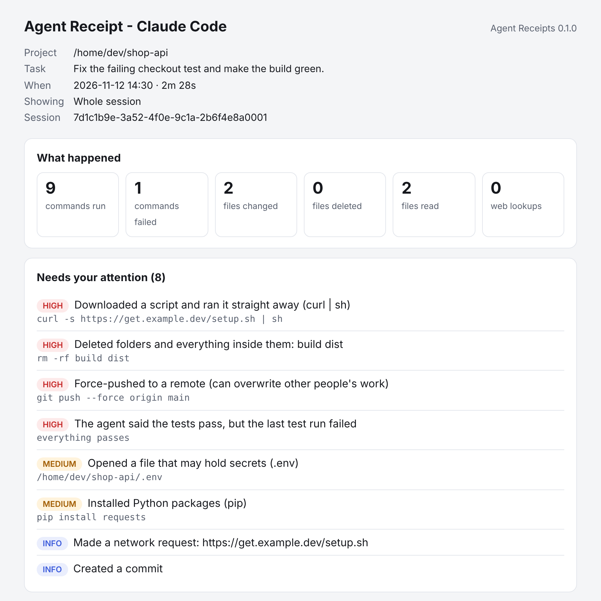

<div align="center">

# 🧾 Agent Receipts

**Your AI coding agent says "Done!" Agent Receipts shows what it *really* did.**

A free, offline tool that turns your agent's session log into a plain-English receipt:
commands it ran, files it changed, risky actions, and whether the tests really passed.

[](https://github.com/hmzamlla21/agent-reciept/actions/workflows/ci.yml)
[](LICENSE)


Works with **Claude Code · Codex CLI · Gemini CLI · OpenCode**



</div>

---

## Why you want this

You ask an AI agent to fix a bug and walk away. It comes back with *"All done, everything passes!"*

But did it?

- Did it run the tests, and did they pass **at the end**, or only halfway through?
- Did it `rm -rf` something, force-push, or run a script it downloaded from the internet?
- Did it open your `.env` file?
- Did it install new packages?

Reading a long session log to find out takes forever. **Agent Receipts does it in one second** and puts the important things at the top.

> **The best part:** if the agent *says* the tests pass but the log shows they failed (or never ran), the receipt calls it out in red.

## What it looks like

```text
AGENT RECEIPT  |  Claude Code
================================================================================
Project   /home/dev/shop-api
Task      "Fix the failing checkout test and make the build green."
Session   7d1c1b9e-3a52-4f0e-9c1a-2b6f4e8a0001
When      2026-11-12 14:30 -> 14:32:30  (2m 28s)
Showing   Whole session

WHAT HAPPENED
  Commands run      9  (1 failed)
  Files          2 edited, 0 written, 0 deleted, 2 read
  Also           0 searches, 0 web lookups, 0 sub-agent tasks
  Tokens         in 16,500 | out 1,160 | cached 65,000

NEEDS YOUR ATTENTION (8)
  [HIGH]   Downloaded a script and ran it straight away (curl | sh)  14:31:39
           curl -s https://get.example.dev/setup.sh | sh
  [HIGH]   Deleted folders and everything inside them: build dist  14:31:58
           rm -rf build dist
  [HIGH]   Force-pushed to a remote (can overwrite other people's work)  14:32:10
           git push --force origin main
  [HIGH]   The agent said the tests pass, but the last test run failed
           everything passes
  [MEDIUM] Opened a file that may hold secrets (.env)  14:30:36
           /home/dev/shop-api/.env
  [MEDIUM] Installed Python packages (pip)  14:31:24
           pip install requests
  [note]   Made a network request: https://get.example.dev/setup.sh  14:31:39
  [note]   Created a commit  14:32:02

TESTS
  [FAIL] The last test run failed.
         3 test run(s). Last: pytest -q tests/test_pricing.py

  ... then every file changed, every command, every failure, and what the agent said last.
```

Want to see it as a web page? Open [`examples/receipt-example.html`](examples/receipt-example.html). There is also a [Markdown version](examples/receipt-example.md) you can paste into a pull request or ticket.

---

## Install (step by step)

It takes about two minutes. You need **Python 3.9 or newer** on your computer. Agent Receipts has **no other dependencies**.

### Step 1. Check that Python is installed

Open a terminal (on Windows: PowerShell) and run:

```bash
python3 --version
```

On Windows, if that does not work, try `py --version`. You should see `Python 3.9` or higher.
If not, install Python from [python.org/downloads](https://www.python.org/downloads/) and open a new terminal.

### Step 2. Install `pipx` (it installs command-line tools safely)

| Your computer | Run this |
|---|---|
| **macOS** | `brew install pipx && pipx ensurepath` |
| **Ubuntu / Debian** | `sudo apt install pipx && pipx ensurepath` |
| **Windows** | `py -m pip install --user pipx` then `py -m pipx ensurepath` |
| **Anything else** | `python3 -m pip install --user pipx && python3 -m pipx ensurepath` |

**Close your terminal and open a new one.** This step matters: it lets your terminal find the new tool.

> Prefer [`uv`](https://docs.astral.sh/uv/)? Skip pipx and run `uv tool install git+https://github.com/hmzamlla21/agent-reciept.git` in the next step instead.

### Step 3. Install Agent Receipts

```bash
pipx install git+https://github.com/hmzamlla21/agent-reciept.git
```

### Step 4. Check that it works

```bash
agent-receipts doctor
```

You should see a line starting with `[ok]` for each agent you have used. A line starting with `[none]` just means you have not used that agent on this computer. That is fine.

### Step 5. Get your first receipt

```bash
agent-receipts
```

That is it. By default you get a receipt for your **most recent session**, from whichever agent you used last.

### Step 6 (optional, recommended). Add a `/receipt` command inside your agents

```bash
agent-receipts install
```

This adds a small `/receipt` command to every agent it finds on your computer, so you can ask for a receipt **in the middle of a session** without leaving the agent. Add `--dry-run` first if you want to see what it will do.

| Agent | What to type inside the agent |
|---|---|
| Claude Code | `/receipt` |
| Codex CLI | `/prompts:receipt` |
| Gemini CLI | `/receipt` |
| OpenCode | `/receipt` |

Restart an agent that was already open so it sees the new command. You can add options too, for example `/receipt --turn`.

### Update or remove

```bash
pipx upgrade agent-receipts                  # get the newest version
agent-receipts install --uninstall           # remove the /receipt commands
pipx uninstall agent-receipts                # remove the tool
```

### Just want to try it once, without installing?

```bash
pipx run --spec git+https://github.com/hmzamlla21/agent-reciept.git agent-receipts
```

---

## Everyday use

```bash
agent-receipts                         # receipt for your newest session
agent-receipts --turn                  # only what the agent did since your last message
agent-receipts --since 2h              # only the last two hours (also 30m, 1d)
agent-receipts --format html --open    # make a web page and open it in your browser
agent-receipts --format md -o receipt.md   # save as Markdown (great for pull requests)
agent-receipts list                    # see your recent sessions
agent-receipts --nth 2                 # the second newest session
agent-receipts --agent codex           # pick an agent
agent-receipts --project my-app        # only sessions from a folder that contains "my-app"
agent-receipts --project .             # only sessions from the folder you are in now
```

<details>
<summary><b>All options</b></summary>

| Option | What it does |
|---|---|
| `--agent`, `-a` | `claude-code`, `codex`, `gemini` or `opencode`. Default: whichever you used most recently. |
| `--turn` | Only the agent's latest turn (since your last message). |
| `--since TIME` | Only the last stretch of time, like `30m`, `2h` or `1d`. |
| `--format` | `text` (default), `md`, `html` or `json`. |
| `--output`, `-o` | Save to a file. The format is picked from the file ending (`.html`, `.md`, `.json`). Use `-` to print instead. |
| `--open` | Open the HTML receipt in your browser. |
| `--nth N` | Use the Nth newest session. |
| `--session ID` | Use the session whose id starts with `ID`. See `agent-receipts list`. |
| `--file PATH` | Use one exact session file. |
| `--dir FOLDER` | Look for logs in this folder (if your agent keeps them somewhere unusual). |
| `--project TEXT` | Only sessions whose project folder contains `TEXT`. |
| `--max-items N` | How many commands to list. `0` shows all. |
| `--fail-on high\|medium\|tests` | Exit with code `4` if this is found. For scripts and CI. |
| `--no-redact` | Do **not** hide secrets. Only for your own screen. |
| `--no-color`, `--width N` | Look of the text output. The `NO_COLOR` setting is respected. |

**Exit codes:** `0` fine · `1` error · `2` wrong usage · `3` no sessions found · `4` `--fail-on` matched.

</details>

---

## What it checks

| It tells you | Examples |
|---|---|
| **Did the tests really pass?** | `PASS`, `FAIL`, `STALE` (files changed after the last passing run), or `NO TESTS` run at all. |
| **Did the agent's words match the log?** | Flags "all tests pass" when the last run failed, or no tests ran. |
| **Deleting things** | `rm -rf`, `find -delete`, `git clean`, `git reset --hard`, deleting a branch. |
| **Risky git** | Force-push, rewriting history, `--no-verify`, `--amend`, pushing to a remote. |
| **Running unknown code** | `curl … \| sh`, and installing packages (`npm`, `pip`, `cargo`, `brew`, `apt` and more). |
| **Secrets** | Opening or changing `.env`, SSH keys, `.pem` files, cloud credentials. |
| **Leaving the project** | Editing files outside the project folder, shell start-up files, `/etc`. |
| **Big actions** | `sudo`, `terraform apply`, `kubectl delete`, deploys, package publishing, `chmod 777`. |
| **Sneaky changes** | CI/CD pipeline edits, git hooks, the agent changing its own settings. |
| **What failed** | Every failed command with its error message. |

It also lists every command and every file the agent changed, with times and token counts (when your agent saves them).

## Supported agents

| Agent | Reads logs from | Notes |
|---|---|---|
| **Claude Code** | `~/.claude/projects/` | Also checked against a real session. |
| **Codex CLI** | `~/.codex/sessions/` | File reads done with `cat` show up as commands. Compressed `.zst` logs need the `zstd` command. |
| **Gemini CLI** | `~/.gemini/tmp/*/chats/` | Gemini does not save the project folder, so it is guessed from the files touched (the receipt tells you). |
| **OpenCode** | `~/.local/share/opencode/storage/` | Versions that keep sessions in a database (`.db`) cannot be read yet. `doctor` tells you if that is your case. |

**Using another tool (Cursor, Windsurf, Cline, Aider, Copilot…)?** They are not supported yet, because each tool saves its logs differently. [Request one](https://github.com/hmzamlla21/agent-reciept/issues/new?template=agent_support.yml) or [add it yourself](CONTRIBUTING.md#add-a-new-agent). It is about one small file.

## Privacy and safety

- **100% local.** It only reads files on your computer. It makes no network requests and sends nothing anywhere. No tracking.
- **Read-only.** It never changes your session logs or your code. The only files it writes are the ones you ask for with `--output` and, if you run `install`, one small command file per agent.
- **Secrets are hidden by default.** API keys, tokens, passwords in URLs, private keys and similar are replaced with `[hidden]`, so a receipt is safe to share. This is **best effort**: it catches the common shapes, not every possible secret. Look before you share.
- **Warnings are hints, not a guarantee.** They help you review quickly. They are not a security sandbox, and a command can be risky in ways a simple check will miss. For hard limits, use your agent's own permission settings.

## How it works (and its limits)

Every coding agent writes a log of each session. Agent Receipts reads that log, converts each tool into one common format, applies a set of rules, and prints the result. In plain words:

- **Changes made through shell commands** (for example `sed -i`, or a script that writes files) are not listed under "Files changed". The command itself is still listed, and common cases get a note.
- **The "agent said tests pass" check looks for plain phrases** such as "all tests pass" or "everything passes", and ignores sentences with "not" or "still". It can miss unusual wording.
- **Test detection** recognises the common runners (pytest, jest, `npm test`, `go test`, `cargo test`, `make test` and more). A custom script with an unusual name will count as "no tests run".

## Troubleshooting

| Problem | What to do |
|---|---|
| `agent-receipts: command not found` | Run `pipx ensurepath`, then **close and reopen your terminal**. |
| `No coding-agent sessions were found` | Run `agent-receipts doctor` to see where it looked. If your logs are somewhere else, use `--dir FOLDER` or `--file PATH`. |
| A `/receipt` command does not appear in my agent | Restart the agent. Run `agent-receipts install --dry-run` to see where the file goes. |
| `install` says "already exists with different content" | You edited the file. Use `--force` to replace it. |
| OpenCode shows a database message | Your OpenCode keeps sessions in a database. That is not supported yet ([see the issue tracker](https://github.com/hmzamlla21/agent-reciept/issues)). |
| The receipt shows the wrong project | Use `--project TEXT` or `--nth N`, or look at `agent-receipts list`. |
| Odd characters on Windows | Use Windows Terminal or PowerShell 7. Or add `--no-color`. |
| Something else | Run again with `AGENT_RECEIPTS_DEBUG=1` and [open an issue](https://github.com/hmzamlla21/agent-reciept/issues/new?template=bug_report.yml). |

## What has been tested

- Automated tests run on every change with GitHub Actions: Linux, macOS and Windows, on Python 3.9, 3.12 and 3.13.
- Each log reader is tested against sample logs written to match that agent's documented log format, including bad and half-written lines.
- The Claude Code reader was also run on a real session.
- The `/receipt` command files follow each agent's documented custom-command format. If one does not work in your version, please [tell us](https://github.com/hmzamlla21/agent-reciept/issues/new?template=bug_report.yml).

## Contributing

Bug reports, new agents and new rules are all welcome. See [CONTRIBUTING.md](CONTRIBUTING.md). To run the tests: `python3 -m unittest discover -s tests`.

Ideas on the roadmap: support for more agents, a `--watch` mode, a GitHub Action that posts a receipt on pull requests, and publishing to PyPI.

## License

[MIT](LICENSE). Free to use, change and share.

---

<div align="center">

If Agent Receipts saved you from a bad surprise, please ⭐ the repo. It helps other people find it.

</div>
